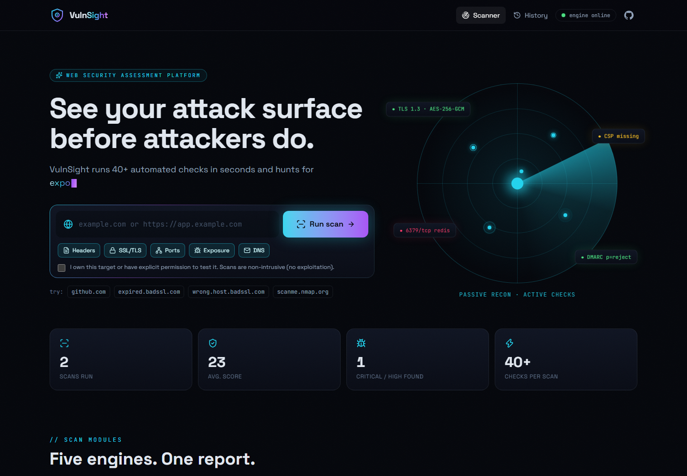
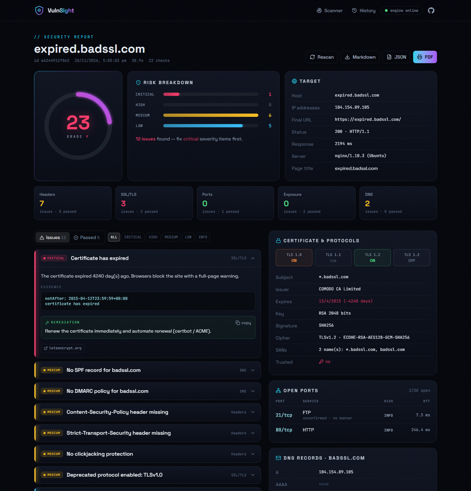

<div align="center">


# VulnSight

**Web security assessment platform.** Point it at a domain and it finds security misconfigurations and likely vulnerabilities, then tells you how to fix each one.




</div>

---

## ✨ Features

| Module | What it checks |
|---|---|
| 🧾 **HTTP Security Headers** | Content-Security-Policy (missing *and* weak: `unsafe-inline`, `unsafe-eval`, wildcards), HSTS (missing, short `max-age`, no `includeSubDomains`), clickjacking (X-Frame-Options / `frame-ancestors`), X-Content-Type-Options, Referrer-Policy, Permissions-Policy, COOP, server/framework **version disclosure** |
| 🔒 **SSL / TLS** | Certificate trust chain, **expiry**, hostname mismatch, self-signed certs, key strength (RSA < 2048), SHA-1/MD5 signatures, **TLS 1.0 / 1.1 / 1.2 / 1.3 support matrix**, weak cipher suites |
| 🛰️ **Ports & Services** | Concurrent async TCP scan of 30 high-risk ports (Redis, MongoDB, Elasticsearch, Docker API, SMB, RDP, MySQL, Postgres, Telnet, FTP…) with **banner grabbing**. Ports that accept a connection but never send their protocol's greeting are marked *unconfirmed*, which filters out firewall/AV false positives |
| 🕳️ **Misconfiguration & Exposure** | Exposed `/.git`, `/.env`, SQL dumps, config backups, `.htpasswd`, Spring actuator, `server-status`, `phpinfo`, `.DS_Store` (each one is checked against the file's actual content, not just the status code). Also **CORS origin reflection**, cookie `Secure`/`HttpOnly`/`SameSite` flags, HTTP→HTTPS redirect, directory listing, sensitive `robots.txt` entries, `security.txt` |
| ✉️ **DNS & Email Security** | SPF (missing / `+all`), DMARC (missing / `p=none`), CAA, IPv6, MX/NS inventory |

**Platform**
- ⚡ **Live scan view**: radar animation, per-module status and a streaming terminal log
- 📊 **Weighted 0–100 score and A+ to F grade**: one critical finding caps the grade at F, one high caps it at C
- 🛠️ **Each finding comes with evidence, a remediation you can copy and reference links** (OWASP, MDN, RFCs)
- 📁 **Export reports** to Markdown, JSON or PDF (print-optimised stylesheet)
- 🗂️ **Scan history** stored in SQLite, with search and delete
- 🛡️ **Safe by design**: an SSRF guard blocks private/loopback/metadata IPs (including after redirects), callers must confirm they're authorised, scans are rate-limited per IP, and the app sends a strict CSP and security headers itself



## 🏗️ Architecture

```
┌──────────────────────┐   POST /api/scans   ┌────────────────────────────────────────────┐
│  React 19 + Vite     │ ──────────────────► │  FastAPI                                   │
│  Tailwind v4         │                     │   ├─ target.py   parse · resolve · SSRF    │
│  Framer Motion       │ ◄────────────────── │   ├─ engine.py   asyncio orchestration     │
│  (polls live state)  │  GET /api/scans/:id │   │    ├─ headers.py                       │
└──────────────────────┘                     │   │    ├─ tls.py        (ssl + cryptography)│
                                             │   │    ├─ ports.py      (async TCP)        │
                                             │   │    ├─ exposure.py   (httpx)            │
                                             │   │    └─ dns_checks.py (dnspython)        │
                                             │   ├─ storage.py  SQLite history            │
                                             │   └─ report.py   Markdown export           │
                                             └────────────────────────────────────────────┘
```

All five modules run **concurrently** with `asyncio.gather`. If one module fails, the scan still finishes and that module is marked as errored. Partial results stream to the UI while the scan runs.

## 🚀 Quick start

### Option 1: Docker (one command)

```bash
docker build -t vulnsight .
docker run -p 8000:8000 vulnsight
# open http://localhost:8000
```

### Option 2: Local development

**Backend** (Python 3.12+)

```bash
cd backend
python -m venv .venv
# Windows: .venv\Scripts\activate   |   macOS/Linux: source .venv/bin/activate
pip install -r requirements.txt
uvicorn app.main:app --reload --port 8000
```

**Frontend** (Node 20+), in a second terminal

```bash
cd frontend
npm install
npm run dev
# open http://localhost:5173  (API calls are proxied to :8000)
```

**Production build without Docker**: run `npm run build` in `frontend/`, then start uvicorn. FastAPI serves `frontend/dist` automatically, so the whole app runs at `http://localhost:8000`.

### Try these targets
`github.com` (well hardened) · `expired.badssl.com` (expired cert) · `wrong.host.badssl.com` (hostname mismatch) · `scanme.nmap.org` (Nmap's public scan target)

## 🔌 REST API

Interactive docs are at **`/docs`** (Swagger UI).

| Method | Endpoint | Description |
|---|---|---|
| `POST` | `/api/scans` | Start a scan: `{ "target": "example.com", "modules": ["headers","tls","ports","exposure","dns"], "authorized": true }` |
| `GET` | `/api/scans/{id}` | Live or finished scan: status, progress, log, findings, score |
| `GET` | `/api/scans` | Scan history |
| `DELETE` | `/api/scans/{id}` | Delete a scan |
| `GET` | `/api/scans/{id}/report.md` | Markdown report |
| `GET` | `/api/scans/{id}/report.json` | JSON report |
| `GET` | `/api/stats` | Aggregate stats |
| `GET` | `/api/health` | Health check |

```bash
curl -X POST localhost:8000/api/scans -H "content-type: application/json" \
     -d '{"target":"example.com","authorized":true}'
```

## 🧮 Scoring

Each failed or warning check subtracts points by severity: **critical 25 · high 14 · medium 7 · low 2 · info 0**. Passed checks never cost points.
Caps: any **critical** finding sets the maximum score to 49 (F), and any **high** finding sets it to 74 (C).
Grades: A+ ≥ 95 · A ≥ 85 · B ≥ 75 · C ≥ 65 · D ≥ 50 · F < 50.

## ⚙️ Configuration

| Variable | Default | Purpose |
|---|---|---|
| `VULNSIGHT_ALLOW_PRIVATE` | `0` | Allow scanning private/loopback IPs (local labs only) |
| `VULNSIGHT_RATE_LIMIT` | `6` | Scans per client IP per minute |
| `VULNSIGHT_DB` | `backend/vulnsight.db` | SQLite path |
| `VULNSIGHT_HTTP_TIMEOUT` | `8` | HTTP timeout (seconds) |
| `VULNSIGHT_CORS` | `http://localhost:5173` | Allowed dev origins |

## ☁️ Deploy

The repo ships a `Dockerfile` and a `render.yaml` blueprint. On [Render](https://render.com): **New → Blueprint →** pick this repo. Any Docker host also works (Railway, Fly.io, a VPS).
> Port scanning needs outbound TCP, so serverless platforms that only allow HTTP egress (for example Vercel functions) can't run the ports module.

## 🧪 Tests

```bash
cd backend && pip install pytest && pytest -q
```

The tests cover target parsing, the SSRF guard (including IPv4-mapped IPv6), header analysis, cookie flags, scoring/grade caps and the API's validation paths. GitHub Actions runs the backend tests, the frontend build and the Docker build on every push.

## 📂 Project structure

```
backend/
  app/
    main.py            FastAPI app, routes, rate limiting, SPA serving
    engine.py          scan orchestration + scoring
    storage.py         SQLite persistence
    report.py          Markdown report generator
    models.py          Finding / ScanRequest models
    scanners/          headers · tls · ports · exposure · dns_checks · target · http
  tests/
frontend/
  src/
    pages/             Home · ScanPage (live + report) · History
    components/        Layout · Visuals (radar, score ring, terminal) · FindingCard · Panels
    lib/api.ts         typed API client
Dockerfile · render.yaml · .github/workflows/ci.yml
```

## ⚠️ Legal & ethics

VulnSight runs **non-intrusive** checks only. It does not exploit anything, brute-force logins or fuzz inputs. Even so, port scanning and probing can break the rules of some networks, so **only scan systems you own or have explicit written permission to test.** Treat findings as leads to confirm by hand, not as final verdicts.

---

<div align="center">Built by <a href="https://github.com/ALLaNRoY-TECH">ALLaNRoY-TECH</a> · Python · FastAPI · React · Cybersecurity</div>
